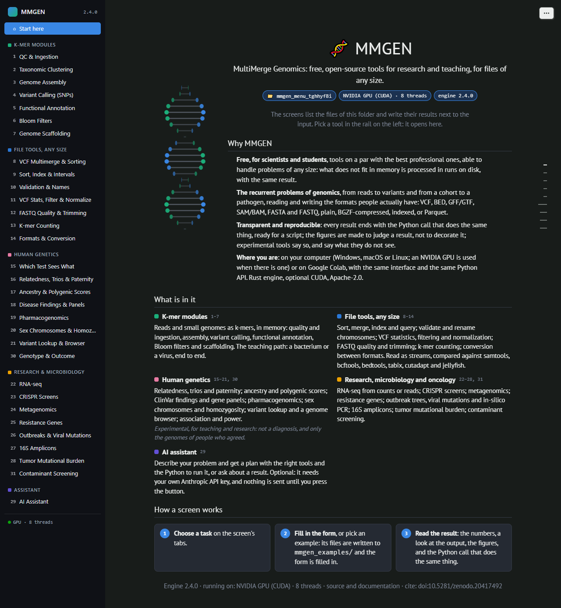
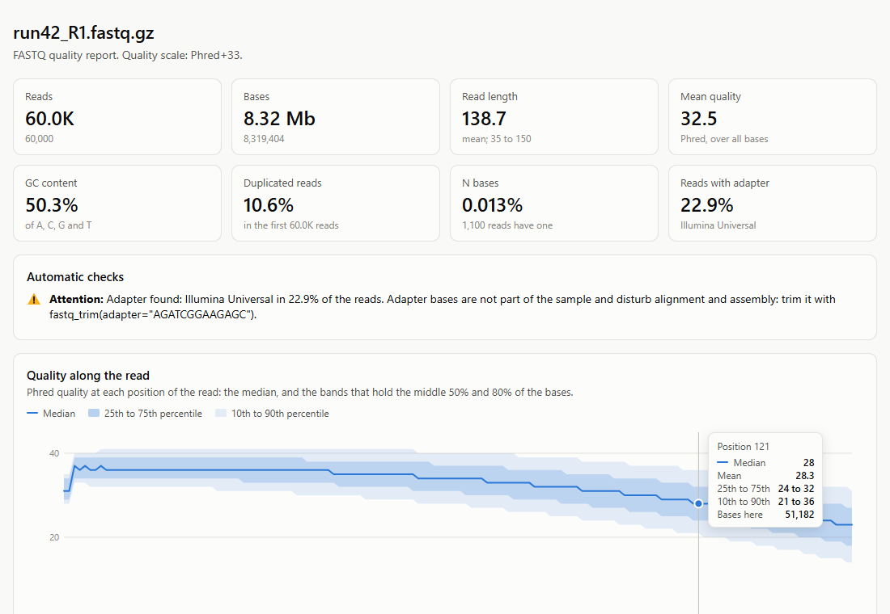
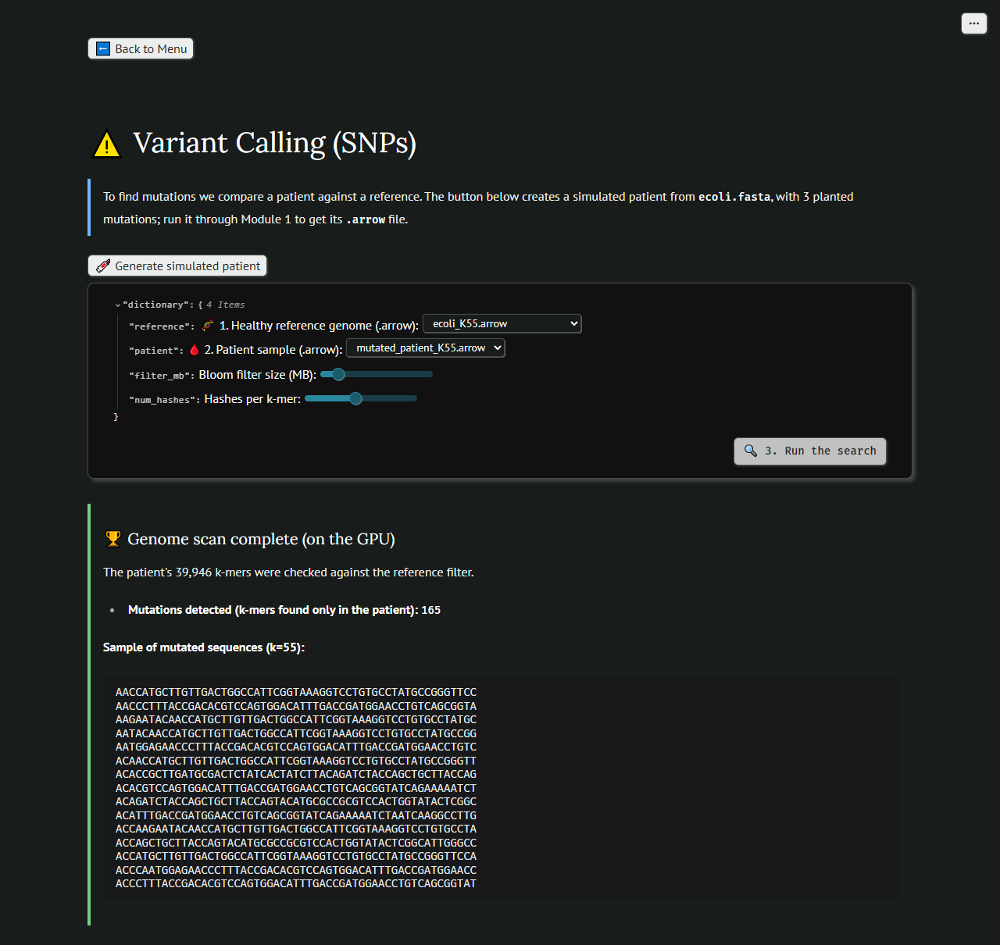

# 🧬 MMGEN: MultiMerge Genomics Engine Suite

[](https://doi.org/10.5281/zenodo.20417492) [](https://pypi.org/project/multimerge-genomics/) [](https://colab.research.google.com/github/fbcouto/multimerge-genomics-research/blob/main/colab/MultiMerge_Genomics_Colab.ipynb)



MMGEN is a free, open-source genomics toolkit written in **Rust**, with optional **CUDA** acceleration and a **Python** API. It has four families of tools, plus an optional AI assistant:

* **Everyday file tools that work at any size** — validate a file and say what is wrong with it, fix `chr1` versus `1`, tell GRCh37 from GRCh38; sort, index and query by region; merge, intersect, subtract, complement, find the closest and measure the coverage of intervals; count, filter and normalize variants; measure the quality of FASTQ reads (with an HTML report) and trim them; count k-mers. On VCF, BED, GFF/GTF, SAM/BAM, FASTA and FASTQ files that do not fit in memory, read and written as plain text, gzip (BGZF), BAM or Parquet.
* **K-mer modules** — ingestion and quality filtering, De Bruijn assembly, mutation detection with Bloom filters, translation and scaffolding, running on an NVIDIA GPU when there is one and on the CPU when there is not.
* **Human genetics** *(experimental, for teaching and research)* — relatedness, trios and paternity; ancestry and polygenic scores; ClinVar findings and gene panels; pharmacogenomics (MMGEN's own engine, or PharmCAT); sex chromosomes and runs of homozygosity; a known variant looked up in relatives, and the reads over a position; the association of genotypes with an outcome in a cohort, and the power of a study.
* **Research, microbiology and oncology** *(experimental, for teaching and research)* — RNA-seq from the FASTQ reads to differential expression and gene sets; CRISPR screens; metagenomics; antimicrobial resistance genes; outbreak trees and viral mutations; 16S amplicons; tumor mutational burden; screening a biological material for adventitious agents.
* **An AI assistant** *(optional; uses the Claude API)* — describes a path through the tools for a problem, explains a result, and runs the tools with your approval; the session is saved as a Python script.

You can use it from Python or from a web interface with 31 screens, **on your own computer or on Google Colab** (free or paid) with nothing installed on your machine: see [Two ways to run it](#-two-ways-to-run-it).

MMGEN is free (Apache 2.0). If it is useful to you, you can [support its development](#donate) — entirely optional.

---

## ✨ Highlights

* **Any size.** Sorting is bounded by a memory budget, not by the input. Two real dbSNP VCFs totalling 18.7 GB of text (75.2 million variants) are sorted and merged in 242 s within a 1 GB budget on a 4-core laptop.
* **Stable, so merges are deterministic.** Records with the same key keep their input order: file order, then line order.
* **Errors that explain themselves.** The validator gives the line, the reason and the fix. An intersection between a `chr1` file and a `1` file fails with a message that names the mismatch instead of silently returning nothing.
* **The formats you already have, in and out.** Plain text, gzip (written as BGZF, so it can be indexed), `.tbi` and `.bai` indexes for region queries, BAM, and Parquet tables that pandas, polars, DuckDB or Spark read directly. Every tool reads and writes all of them; the file extension decides.
* **Checked against the tools it replaces.** `fastq_trim` writes the same reads as cutadapt (0 differences in 128,800 reads over 84 option combinations); BAM files are read back by an independent reader, using our own `.bai`; Parquet files are read by pyarrow and polars, and theirs by us.
* **No GPU required.** Every GPU path has a CPU twin that returns the same result, bit for bit. With a GPU, the Bloom filter is 3× to 8× faster.
* **One wheel per platform.** The extension is built against Python's stable ABI and serves every Python from 3.10 on.
* **Tested.** 11,744 Rust tests, plus Python tests that drive the API with real data, compare it with independent tools, and drive the interface in a real browser.

What the validator says about one of the example files of the Colab notebook, which has defects planted on purpose:

```text
examples/with_defects.vcf: VCF with 8007 lines and 8000 records -- 4 error(s), 1 warning(s)
  ERROR   line 8: the file mixes the two chromosome naming conventions: `chr1` (line 48) and `1` (line 8)
          fix: normalize_chromosomes(...) rewrites the file in a single naming convention
  ERROR   line 18: has 7 tab-separated column(s) but 8 when split on spaces: the columns must be separated by TABS (a VCF needs at least 8: CHROM POS ID REF ALT QUAL FILTER INFO)
          fix: replace the spaces between the columns with tabs
  ERROR   line 28: POS `12mil` is not an integer
  ERROR   line 38: REF `N?` has the invalid character `?` (only A, C, G, T and N are allowed)
  WARNING line 48: sequence `chr1` is not declared in any `##contig` line of the header
  INFO    line 10: the file is not sorted: sequence `1` shows up again here, after other sequences [7014 occurrences]
          fix: sort_genomic(...) sorts the file, whatever its size
```

---

## 🚀 The Modules

Every module has a screen in the web interface, and every function is also available from Python. On every file, human-genetics and research screen (9–28, 30 and 31), each result ends with the Python call that does the same thing, ready to paste into a script. The Colab notebook covers modules 9 and 10.

### 🔬 1. QC & Ingestion (FASTQ / FASTA)
* **Batch reading, gzip included:** reads several `.fastq`, `.fasta`, `.fastq.gz` or `.fasta.gz` files in parallel and decompresses them on the fly.
* **128-bit k-mers:** k-mers of up to `k=63` packed into 16 bytes each. The output is the sorted set of distinct k-mers.
* **Quality filter:** FASTQ reads whose mean Phred quality is below the threshold are dropped before their k-mers are extracted.

### 🧬 2. Taxonomic Clustering *(experimental)*
* Groups DNA by its composition, as metagenome binning tools (MetaBAT, CONCOCT) do: sequences (genomes, contigs, long reads) are cut into windows, each window is described by the frequencies of its 136 tetranucleotides (both strands together), and the windows are projected with PCA and grouped with HDBSCAN, with a table of where each group's windows came from and a scatter of the first two components.
* Composition separates species, not strains: on four bacterial isolates (two *Klebsiella pneumoniae*, two *Staphylococcus aureus*, 10 kb windows) it gives two groups, one per species (57% and 33% GC), with the two strains of each together; three simulated genomes of equal GC but different 4-base word preferences come out as three groups of 20 windows each.

### 🧩 3. Genome Assembly (De Bruijn)
* Builds the De Bruijn graph of the k-mers in memory and walks its unbranched paths to produce contigs (unitigs), written to a FASTA file.
* Collapses the simplest bubbles (two one-node branches that reconverge). Longer bubbles, tips and coverage are not handled yet.

### ⚠️ 4. Variant Calling (SNPs), by k-mer difference
* Builds a Bloom filter from the reference k-mers and reports the sample k-mers that are not in it — the k-mers that carry a difference. A single SNP shows up as `k` mutated k-mers.
* Runs on the GPU or on the CPU, with the same result.

### 📘 5. Functional Annotation (Translation)
* Translates DNA into protein with the standard genetic code (reading frame 1), in parallel across sequences. Stop codons are marked.

### 🔍 6. Bloom Filters
* **GPU:** a CUDA kernel sets the bits with `atomicOr`, so thousands of threads can write the same filter safely.
* **CPU:** the same filter, bit for bit, on a machine with no NVIDIA card.

### 🖇️ 7. Genome Scaffolding
* Joins contigs whose ends overlap exactly by a fixed number of bases, using hash maps of the ends.
* Detects sequences that close on themselves (plasmids, circular chromosomes) without looping forever.

### 🗄️ 8. VCF Multimerge & Sorting
* Select any number of `.vcf` / `.vcf.gz` files: the engine merges them into a single output sorted by position or by quality — stable, and out of core when the data does not fit in memory.

### 📏 9. Sort, Index & Intervals, at any size
* **`sort_genomic`** sorts VCF, BED, GFF/GTF and SAM/BAM. What fits the memory budget is sorted in memory; what does not is cut into sorted runs on disk (LZ4) and joined by a k-way merge.
* **The chromosome order you choose:** lexical (`bedtools sort`), natural (`chr2` before `chr10`), the order of the header's `##contig` / `@SQ` lines (`bcftools sort`, `samtools sort`), or the order of a `.fai` file.
* **Index and query by region:** `index_file` writes the `.tbi` of a VCF, BED or GFF and the `.bai` of a BAM — the same indexes tabix, samtools and IGV use — and `query_region` reads only the part of the file a region needs (`"chr1:1000000-2000000"`).
* **Interval operations** on inputs that need not be sorted and need not fit in memory: `bed_merge` (`bedtools merge -d`), `bed_intersect` (`bedtools intersect`, with `-u` and `-v`), `bed_subtract` (with `-A`), `bed_complement`, `bed_closest` (`-d`, every tie), `bed_coverage` and `bed_slop`.
* Malformed lines are skipped and counted, never silently sorted as zero.

### 🩺 10. Validation & Chromosome Names
* **`validate_file`** reads a VCF, BED, GFF/GTF, SAM, FASTA or FASTQ of any size and reports each kind of problem with the **line** of its first occurrence, how many times it repeats and how to fix it.
* **`normalize_chromosomes`** rewrites a whole file, header included, in a single naming convention: UCSC (`chr1`, `chrM`) or Ensembl/NCBI (`1`, `MT`).
* **`compare_references`** compares the sequence lengths two files declare and tells GRCh37 (hg19) from GRCh38 (hg38) before the coordinates of one are used on the other.

### 🧪 11. VCF Statistics, Filtering & Normalization
* **`vcf_stats`**: records per sequence, SNPs, MNPs, insertions, deletions, multiallelic sites, transitions and transversions (Ts/Tv), PASS, missing QUAL and FILTER.
* **`vcf_filter`**: keep the records that match an expression (`QUAL >= 30 && INFO/DP > 10 && FILTER == "PASS"`), fall in some regions, or both; keep some samples, in the order you give. `TYPE` and `FILTER` follow bcftools: `TYPE == "snp"` keeps sites whose every ALT allele is a SNP, `TYPE ~ "snp"` sites with at least one; `FILTER ~ "q10"` keeps sites whose filters include q10. A typo in the expression is reported with the position of the mistake.
* **`vcf_normalize`**: split multiallelic sites into one record per allele (INFO and FORMAT fields declared `Number=A`, `R` or `G` are split with them) and trim every variant to its shortest representation. Give it the genome (`reference="GRCh38.fa"`) and it also checks REF and **left-aligns** every indel, as `bcftools norm -f` does, so files that wrote the same indel at different places of a repeat agree. The output is sorted again when positions move.

### 📈 12. FASTQ Quality Report & Trimming
* **`fastq_stats`** and **`fastq_report`**: quality along the read (median and percentiles), base composition, GC per read, N bases, duplication, read lengths and known adapters, with plain-language warnings that name the fix. The report is one HTML page that opens offline:

  

* **`fastq_trim`**: quality trimming of both ends, 3' adapter removal (`adapter="auto"` uses the adapter the report found), removal of N at the ends, and length, N and quality filters — single-end or paired-end, with the pairs kept in step. Same results as `cutadapt --no-indels`.

### 🔢 13. K-mer Counting at Any Size
* **`count_kmers`** counts the k-mers (k up to 63) of FASTA and FASTQ files of any size within a memory budget, canonical by default (a k-mer and its reverse complement count together), and returns the abundance spectrum (histogram) with the table of counts.

### 📦 14. Formats and Conversion
* **Every tool reads and writes every container**, chosen by the extension: plain text, `.gz` (read as gzip or BGZF, written as BGZF), `.lz4`, `.bam` (for SAM) and `.parquet` (for VCF, BED, GFF and SAM). **`convert_file`** changes only the container: `convert_file("x.sam", "x.bam")`, `convert_file("x.vcf.gz", "x.vcf.parquet")`.
* **Parquet** keeps one typed column per field (positions as integers, QUAL as a number with `.` as null, one column per sample) and the whole header in the file metadata, so it converts back to the same text. QUAL (and the GFF score) can instead be kept as the text it was, for a byte-for-byte round trip: `parquet_options(numbers="text")`. Parquet tables written by pandas, polars or pyarrow are read by their column names (`chrom`, `start`, `end`...).

### 🧬 15–21 and 30. Human Genetics *(experimental, for teaching and research)*

> ⚠️ **Experimental software, for teaching and research only.** These results are not a medical diagnosis, not a paternity test with legal value and not advice on any treatment or medicine. The authors and contributors take no responsibility for decisions made on the basis of them. A finding must be confirmed by an accredited laboratory and interpreted by a qualified professional (a physician or a genetic counselor). Analyze only the genomes of people who have agreed to it: genetic data are sensitive personal data, about the person and about their relatives.

* **15. Which test sees what**: a guide to the common genetic tests (karyotype, microarray, MLPA, panels, exome, short- and long-read genomes, trio sequencing, tumor profiling, Sanger, pharmacogenomic panels, metagenomics, 16S, pathogen genomes, RNA-seq, CRISPR screens), with what each sees, its blind spots, its files, and what MMGEN does with them.
* **16. Relatedness, trios and paternity** — `relatedness` (the KING kinship of every pair, as `plink2 --make-king-table`, and the inferred relationship), `trio_analysis` (Mendelian consistency, de novo candidates, exclusions and the combined paternity index from population frequencies).
* **17. Ancestry and polygenic scores** — `build_panel` / `panel_from_frequencies` (population frequency panels, e.g. from the 1000 Genomes Project), `estimate_ancestry` (admixture proportions with bootstrap errors, as ADMIXTURE's supervised mode), `polygenic_score` (PGS Catalog scoring files, with coverage and the place of the score among the panel's groups).
* **18. Disease findings and gene panels** — `clinvar_findings` (a person's variants that ClinVar lists, with classification, review stars, conditions and zygosity), `gene_regions` (a panel's genes from a GFF annotation).
* **19. Pharmacogenomics** — `pgx_run`, with two engines that give the same result (`pgx_result.schema.json`, shipped with the package): **MMGEN's own engine** (`mmgen-pgx`, no Java) calls 19 genes from a VCF with the CPIC tables (v1.61.0, public domain) and, from the person's reads (a BAM), also **CYP2D6 with its copy number** and the **HLA-A, -B and -C** types; when the positions read fit more than one diplotype, it calls the highest-scoring one, as PharmCAT's Named Allele Matcher does (for NAT2, as PharmCAT also does, the most common one, from CPIC's population frequencies, weighted by the person's ancestry when it is given or estimated with a reference panel: what matters in admixed populations), lists the others with their phenotypes, and warns when one of them would change the phenotype or a recommendation (unphased data, or positions not read). For a **group of people** (a clinical study, a class), `pgx_cohort` runs it on everyone against the medicines of a protocol, e.g. those given around a surgery, and says for each person and medicine what the guideline advises, or why nothing applies (CYP2D6 not called without the reads, or no CPIC guideline for that medicine). MMGEN's engine is the default; **PharmCAT** (the open-source tool of PharmGKB and CPIC; Java 17+) is optional, for comparison, for which MMGEN prepares the input (`pharmcat_run`). Both list the CPIC and DPWG guideline texts and the positions behind each call. The screen downloads PharmCAT and the IPD-IMGT/HLA sequences of release 3.66.0, the one the tables pin, checked by SHA-256 (licensed CC BY-ND: used unmodified, never redistributed with MMGEN); the engine's tables come as a small zip, `mmgen_pgx_tables_cpic-v1.61.0.zip`, with the release.
* **20. Sex chromosomes and homozygosity** — `genetic_sex` (XX / XY from chrX heterozygosity and chrY calls, with flags for X0 and XXY patterns), `runs_of_homozygosity` (as a SNP array shows them, by the sliding-window method of `plink --homozyg`, which tolerates a genotyping error; on HG002 the same runs as plink, coordinate for coordinate; or strictly, where any heterozygous call ends a run).
* **21. Variant lookup and allele counts** — `variant_lookup` (a known variant tested in relatives: cascade testing), `pileup` (the bases the reads show at one position of a BAM).
* **30. Genotype and outcome: association and power** — `genotype_association` (does a variant go with an outcome in a group of people, such as recovery after a treatment or a side effect? One test per allele, adjusted for covariates: linear regression for a measured outcome, logistic regression for yes/no, with **Firth's penalized likelihood** when a small or separated sample breaks the plain fit; Benjamini-Hochberg FDR; with permutations, an empirical and a family-wise p; the report says who was left out and why, and the smallest effect the study could detect), `association_power` (the power of a study, the people it needs, and the smallest detectable effect — the question to ask before a small trial). Checked against `statsmodels` (to 10⁻¹² on real 1000 Genomes genotypes), `plink2 --glm` (4,961 alleles, to plink2's printed precision) and R's `logistf`. Only hard genotype calls are read, and there is no correction for relatives (check with screen 16 first). The screen's examples use a simulated teaching cohort (real SNV positions, simulated genotypes and outcomes) that shows a planted effect, a false hit from population structure, separation, and what 5 patients can and cannot show.

They read any VCF, sorted in natural chromosome order; with a **callable-regions BED** (as Genome in a Bottle publishes), a site absent from the VCF counts as homozygous reference only inside it. Checked against `plink2` (kinship within 3·10⁻⁴ on the Genome in a Bottle trios) and the 1000 Genomes populations (the ancestry of people held out of the panel). The screens' examples use a 49 MB demo pack of public data (Genome in a Bottle, ClinVar, RefSeq, 1000 Genomes, PGS Catalog), built by `trials/python/make_human_demo.py`.

### 🦠 22–28 and 31. Research, Microbiology and Oncology *(experimental, for teaching and research)*

* **22. RNA-seq** — **straight from the reads (FASTQ), with no aligner**: `build_transcript_index` (every k-mer of a transcriptome, both strands, with the set of transcripts that contain it) and `quantify_samples` (each read or pair pseudoaligned and the abundances estimated by the EM of kallisto: estimated counts and TPM per transcript and per gene, the fragment length measured from the pairs, and a gene count table that `differential_expression` reads as it is); `explain_pseudoalignment` shows, for teaching, how one read is assigned, k-mer by k-mer. On the same reads the estimated counts agree with kallisto 0.46.2 to a mean relative difference of 0.3% (2,077 RefSeq transcripts of chromosome 21, 2 million pairs). Or from aligned reads: `count_reads` (reads per gene from BAM files and a GFF/GTF annotation, as `htseq-count` in union mode), `differential_expression` (the DESeq2 method: median-of-ratios size factors, shrunken dispersions, negative binomial GLM, Wald test, Benjamini-Hochberg, independent filtering and Cook's distance), with volcano and MA plots on the screen. On the airway experiment (8 samples, `~ cell_line + dex`), the genes called agree with `pydeseq2` at Jaccard 0.92 and the fold changes at r = 0.9998. `gene_set_test` asks whether a group of genes moves more than the rest (the rank-sum test of limma's `wilcoxGST`, on this screen's result table or DESeq2's): sets from a GMT file, or the built-in **spinal cord injury** sets (reactive astrocytes, glial-scar proteoglycans, fibrotic scar, inflammation, regeneration-associated genes, axonal cytoskeleton, myelin, growth inhibition and RhoA/ROCK, neurotrophins, laminin receptors and chains), for human, rat or mouse symbols.
* **23. CRISPR screens** — `crispr_count` (guide counts from FASTQ against a library, with the offset found automatically) and `crispr_test` (median normalization, mean-variance model and gene ranking by robust rank aggregation, the MAGeCK method): the same guide and gene tables as MAGeCK 0.5.9.5 on its demo data.
* **24. Metagenomics** — `sketch_references` (FracMinHash sketches of reference genomes, the same hashes as sourmash), `gather` (the species of a sample and their abundance, as `sourmash gather`, with host reads reported apart) and `classify_reads` (each read assigned to a species by its k-mers, as Kraken does, with the host reads written apart).
* **25. Resistance genes** — `find_resistance_genes` (assemblies or reads searched for the genes of the NCBI AMRFinderPlus catalog, with identity, coverage, gene class and the drug it acts on).
* **26. Outbreaks** — `genome_distances` / `sketch_distances` (Jaccard, Mash distance and ANI between genomes, from sketches with sourmash's hashes, and the neighbor-joining or UPGMA tree, drawn on the screen and written as Newick), `tree_from_matrix`, `viral_mutations` (each genome aligned to its reference, the substitutions, deletions, insertions and missing stretches named as Nextclade names them, and the amino-acid changes per gene, ORF1ab's frameshift included) and `in_silico_pcr` (primer pairs and probes, IUPAC codes, mismatches and the 3' rule, against genomes on both strands or against reads). On 20 SARS-CoV-2 lineages the mutations are the same as Nextclade 3.29's, genome by genome; the Jaccard matrices are the same as `sourmash compare`.
* **27. 16S amplicons** — `amplicon_asvs` (pairs merged, filtered by expected errors, denoised into ASVs as UNOISE3, chimeras removed as `--uchime3_denovo`), `train_classifier` / `classify_asvs` (the naive Bayesian classifier of the RDP, with saved models), `alpha_diversity`, `beta_diversity` (Bray-Curtis or Jaccard, principal coordinates, PERMANOVA) and `taxa_composition`. On the mothur MiSeq SOP data the Mock community's 20 strains come out exact, denoising gives vsearch's centroids, and the diversity numbers match scikit-bio.
* **28. Tumor mutational burden** — `tumor_mutational_burden` (somatic variants per megabase of the panel's or exome's region, with depth, allele-fraction and PASS filters, optionally coding or non-synonymous only).
* **31. Contaminant screening (adventitious agents)** — `build_screen_database` (the genomes to look for — viruses, bacteria, mycoplasmas, fungi — the process controls and the host, indexed by minimizers with their genome windows; a human host fits in under 1 GB, built in passes within the memory given; the SHA-256 of every file kept) and `contaminant_screen` (the reads of a biological material: host reads set aside, each other read given to its best match, and for each organism its own and shared reads, reads per million, the **breadth** of its genome covered and whether the reads are spread as an infection would spread them, so that reads piled on one region — a vector element, a shared gene — are not a detection; organisms also in a **negative control** reported as background; **spike-ins** with their recovery and the limit of detection; a report in HTML, TSV and JSON with the SHA-256 of every input and of the database, the parameters, the date and the engine version). On simulated spike-in series (1 million read pairs of human host per sample) the limit of detection was 3–10 reads per million, with no call in host-only samples or blanks; on the ZymoBIOMICS mock communities it calls the members present at a detectable level and nothing else. **For research and teaching: releasing a GMP batch requires a validated method and validated software** (ICH Q5A(R2) admits sequencing for adventitious viruses, but the validation is the laboratory's).

The examples of screens 22 (from FASTQ) and 31 use small simulated data sets that come with the package (`multimerge_genomics.demos`); the others a 46 MB demo pack (`mmgen_demo_research_v4.zip`, built by `trials/python/make_research_demo.py`): the airway counts, the MAGeCK demos, sketches of 43 reference genomes, reads of the ZymoBIOMICS mock communities, the AMRFinderPlus catalog, four bacterial isolates, 20 SARS-CoV-2 lineages, sketches of 13 *K. pneumoniae* and 4 *S. aureus*, a PCR panel with its sources, and the SEQC2 somatic calls of a breast-cancer cell line (chromosome 17).


### 🤖 29. AI Assistant *(optional; uses the Claude API)*

An assistant built on Claude, Anthropic's AI, for students who know the question but not yet the tools. It is optional: nothing in MMGEN needs it, and nothing is sent anywhere until you turn it on.

* **Describe your problem** (screen 29) — in your own words, in any language. The answer explains the problem in detail (the biology, the data, what a good answer looks like), lays out a path through MMGEN's screens with the functions and the parameters that matter, says what could go wrong and what MMGEN cannot do, and ends with a Python script that follows the path. The script is checked against MMGEN's catalog before you see it: a function or a parameter that does not exist is pointed out.
* **Ask the AI about this result** — at the bottom of every screen with results: what the tool did, what the numbers mean, whether they look as expected, what could be wrong and what to try next, for a student or for a researcher.
* **Let the AI run a task** (screen 29) — an agent that runs MMGEN's tools on a folder for you. It proposes one round of calls at a time and **nothing runs until you approve it**; it reads and writes only inside that folder, and the human-genome tools are off unless you allow them.
* **The session record** (screen 29) — every tool run in the session, on any screen and by the agent, as a table and as a Python script that does the same again: the record of what you did, for a notebook or the methods section of a report. It needs no AI.

**What is sent, and when.** Only after you agree on screen 29, and only when you press a button: the name of the tool, its parameters with file names only (no folders), a short summary of the result (long lists cut, DNA and protein sequences replaced by their length) and your question; for *Describe your problem*, also the names of the files in the folder you give. Never a file, a genome or a read. Human-genome results (screens 16–21, 28 and 30) need a second agreement, and their answers carry the same notice as those screens: experimental, not a diagnosis, the authors take no responsibility for decisions made on them; analyze only genomes of people who agreed to it. The AI can be wrong: check what it says against the results.

**What it needs.** `pip install "multimerge-genomics[ai]"` (or `pip install anthropic`) and an Anthropic API key from [console.anthropic.com](https://console.anthropic.com) (the API is paid by the owner of the key), typed on screen 29 (kept in memory for the session, never written to disk) or set in `ANTHROPIC_API_KEY`. The model is Claude Opus 5.5 by default; Claude Sonnet 5.5 and Claude Haiku 5.5 are cheaper and faster, and the *effort* setting trades care for speed and cost. On Opus and Sonnet the requests allow the API's server-side fallback: if the model's safety classifiers decline a request, the API may answer it with another model in the same call, and the answer says so. The rules, a glossary, the catalog of every tool and this README go with every request as one cached prompt.

**MMGEN's tools in Claude, or in any MCP client.** `pip install "multimerge-genomics[mcp]"` installs `mmgen-mcp`, a [Model Context Protocol](https://modelcontextprotocol.io) server that offers every tool that takes plain arguments (79 of them, the human-genome tools included, with their documentation and a JSON schema, plus a catalog of the screens) to Claude Desktop, Claude Code or any other MCP client. Paths are relative to a working folder, and no path outside it is accepted, for reading or for writing. For Claude Desktop, in `claude_desktop_config.json`:

```json
{"mcpServers": {"mmgen": {"command": "mmgen-mcp", "args": ["--root", "C:/path/to/your/data"]}}}
```

The same pieces are open to Python, in `multimerge_genomics.ai`: `catalog()` and `tool_definitions()` (every tool as a Claude tool definition), `Assistant` (`explain`, `plan` and their streaming forms), `Agent` (the approval loop), `Recorder` (the session record) and `check_script` (an answer's Python checked against the catalog).

## 🔎 Diagnostic figures

The screens draw the figures in which the usual artefacts show — what a summary number hides. They are not decoration. Each figure has a **⬇️ SVG** button (a vector file for a paper) and a line on what to look for:

| Screen | Figure | What it reveals |
| :--- | :--- | :--- |
| 3, 7 | **Assembly graph**, as Bandage draws it: the unitigs (or the contigs) and their overlaps | tips (sequencing errors), bubbles (a SNP or an error), repeats (where an assembly breaks), rings (circular molecules) |
| 1, 13 | **K-mer spectrum**, log and linear, read as GenomeScope's plot is read | the error k-mers, the coverage peak, a second peak at half of it (a diploid genome with heterozygous sites), and from them the genome size, the repeats and a rough heterozygosity, before any assembly |
| 12 | **FASTQ report**: quality bands over FastQC's good / reasonable / poor zones; base composition; GC per read against the normal curve | where to trim; primer bias at the start, adapters at the end; a second GC peak (contamination by another organism) |
| 16 | **Kinship against IBS0** (the KING plot) with the degree thresholds | parent and child against siblings; pairs between the bands (a swapped or contaminated sample) |
| 17 | **STRUCTURE-style bars** and a **PCA** of the people on the panel's groups (clouds simulated from the panel's frequencies) | admixture; ancestry the panel does not hold (a person far from every cloud) |
| 19 | **Evidence matrix** of a pharmacogene with alternative calls: positions × candidate star alleles, and what was read; with the reads, **CYP2D6 copies along the gene** against diploid controls | which unphased or unread position leaves more than one diplotype possible; a deletion (*5), a duplication, or a hybrid with CYP2D7 (only part of the gene changed) |
| 21 | **Genome browser** (IGV-like) over a position of a BAM: reference, genes, coverage coloured where the bases differ, reads by strand with their mismatches, clips, deletions and insertions; strand bias (Fisher, SOR) and the place of the ALT base in the reads | a real variant against an artefact: on one strand only, only near read ends, only in clipped or low-quality bases, only in reads with mapping quality 0 |
| 20 | **Karyogram** of the runs of homozygosity | a few long runs (related parents), many short ones (an old, small population), a whole chromosome (uniparental disomy) |
| 22 | Volcano and MA plots; **PCA of the samples**, **distances between samples**, **histogram of the p-values** | a swapped sample, a batch effect, a test that does not fit the data |
| 26 | **Genomes along the reference**, as Nextclade draws them | a real deletion (red, shared by a lineage) against a stretch not read (grey, an amplicon dropout) |
| 27 | **Sunburst** of the taxonomy; **PCoA with 95% ellipses** | the composition rank by rank; group separation against group dispersion |
| 30 | **QQ plot** with λGC, **forest plot**, **Manhattan plot** | inflation (population structure, relatives) against true signals; how wide the intervals are |
| 31 | **Where the reads fall on each genome**, window by window | an infection (reads spread over the genome) against a vector element or a shared gene (a few windows in one place) |

**Optional 3-D views, drawn only when asked.** Under the figures of screens 2, 3, 7, 17, 22 and 27 (the composition PCA, the two assembly graphs, the ancestry PCA, the PCA of the samples and the PCoA) a button, **🧊 Draw the 3-D view**, renders the same data in three dimensions with WebGL, in the browser: drag to rotate, wheel to fly towards whatever is under the cursor (the camera goes right into a cloud, to see the boundaries inside it, and a drag there looks around), right button to pan, hover a point for its name, click a legend entry to hide a group. On screen 2 a thin line joins the consecutive windows of each sequence, the walk of a contig through composition space (a contig that crosses groups is chimeric, or carries a region of another composition); a **Links** button shows or hides these lines, as it does the edges of a graph. Nothing is computed or downloaded until the button is clicked; the graph layout is laid out in three dimensions by the server first (a few seconds for a few thousand unitigs). The pages are self-contained HTML (`multimerge_genomics.webgl`), usable from a script as well: `webgl.scatter3d(points, axes, title, links=...)` and `webgl.graph3d(nodes, edges, title)` return the HTML.

The same figures are open to scripts and notebooks, as standalone SVG with no plotting library:

```python
import multimerge_genomics as mmg
from multimerge_genomics import figures

r = mmg.genotype_association("cohort.vcf.gz", "phenotypes.tsv", "recovery_score", covariates=["age", "sex"])
figures.save(figures.qq_plot([x["p"] for x in r["rows"]]), "qq.svg")
figures.save(figures.manhattan(r["rows"]), "manhattan.svg")
```

## 🎒 Two ways to run it

| | **On your computer** | **On Google Colab** |
| :--- | :--- | :--- |
| What you need | Windows 10/11 (64-bit), macOS 11+ (Apple Silicon or Intel) or Linux (x86-64), Python 3.10+, 4 GB of RAM (8 GB or more for large files); an NVIDIA GPU is optional | A browser and a Google account |
| Your data | stays on your machine | is uploaded to the Colab machine (or read from your Google Drive) |
| Cost | free | free plan, or a paid plan of your choice for more |
| Best for | your own files, any size your disk holds | a machine that cannot run it (a Chromebook, a tablet, little memory), a class, a GPU |

### On your computer

```bash
python -m venv mmgen
mmgen\Scripts\activate           # Windows   (macOS, Linux: source mmgen/bin/activate)

# Windows, macOS or Linux, without an NVIDIA GPU: from PyPI
pip install "multimerge-genomics[ui,ai]"

# With an NVIDIA GPU, the CUDA builds attached to the release (they also run without a GPU):
# Windows (CUDA 11.8)
pip install "multimerge-genomics[ui,ai] @ https://github.com/fbcouto/multimerge-genomics-research/releases/download/v2.5.0/multimerge_genomics-2.5.0-1cuda-cp310-abi3-win_amd64.whl"
# Linux (glibc 2.28 or newer)
pip install "multimerge-genomics[ui,ai] @ https://github.com/fbcouto/multimerge-genomics-research/releases/download/v2.5.0/multimerge_genomics-2.5.0-cp310-abi3-manylinux_2_28_x86_64.whl"

cd folder/with/your/files
mmgen-ui                           # the web interface opens in your browser
```

`mmgen-ui` serves the interface on this computer only (`http://127.0.0.1:2718`), and its screens list and write the files of the folder it is started in (or `--folder`). The extras are optional: `[ui]` is the web interface, `[ai]` the AI assistant; the Python API needs neither. The CPU-only packages (Windows, macOS on Apple Silicon and Intel, Linux with glibc 2.17 or newer) come from [PyPI](https://pypi.org/project/multimerge-genomics/), built and tested by the project's continuous integration; `pip` picks the one for your system. The CUDA packages are attached to the release [v2.5.0](https://github.com/fbcouto/multimerge-genomics-research/releases/tag/v2.5.0), with the same CPU-only packages.

### On Google Colab: free or paid, your choice

[Open the notebook in Colab](https://colab.research.google.com/github/fbcouto/multimerge-genomics-research/blob/main/colab/MultiMerge_Genomics_Colab.ipynb), then *Runtime → Change runtime type → GPU* if you want one, and run its cells: section 1 installs MMGEN on the Colab machine and section 9 opens the web interface. You work in your browser; the tools run on Google's machine.

* **Free plan** — everything works. The web interface opens inside the notebook (Colab's free-plan rules do not allow using a runtime mainly through a web page outside the notebook). GPUs and session time depend on availability.
* **Paid plan** — [Colab Pro, Pro+ or Pay As You Go](https://colab.research.google.com/signup), if you want it: faster GPUs (L4, A100), more memory, longer sessions, and the web interface can also open in its own browser tab, through Colab's own link that works only for you.

Either way, the files you write on Colab are gone when the session ends: download them, or work in a folder of your Google Drive.

---

## 💻 Quick Start

### Prerequisites
* Rust toolchain (`cargo`, `rustc`) — the stable channel is enough
* Python 3.10+
* NVIDIA CUDA Toolkit 11.8+ — optional, only for GPU acceleration
* On Windows: Visual Studio 2022 Build Tools

Ready-made packages of the release v2.5.0 are above ([Two ways to run it](#-two-ways-to-run-it)); this section builds from source.

### Build and install
```bash
# from a clone of this repository
python -m venv .venv
.venv\Scripts\activate            # Windows
# source .venv/bin/activate       # Linux / macOS

pip install maturin
maturin develop --release         # builds the extension and installs it into the venv

# check the installation: any machine, no data needed, a few seconds
python trials/python/smoke.py
```

To build a wheel instead: `maturin build --release --locked -o dist`, then `pip install dist/*.whl`.

**No GPU? It still works.** Without the CUDA toolkit the build succeeds in CPU mode, and the GPU modules give the same results on the CPU. A build made with CUDA also runs on a machine with no usable NVIDIA card. `engine_info()` tells which build you have and whether a GPU is usable right now.

**Building with CUDA on Windows:** `nvcc` needs `cl.exe`. Either build from the "x64 Native Tools Command Prompt for VS 2022", or load that environment first with `call "...\VC\Auxiliary\Build\vcvars64.bat"`.

| Build variable | Effect |
| :--- | :--- |
| `MULTIMERGE_CPU_ONLY=1` | Do not try CUDA at all |
| `MULTIMERGE_CUDA_ARCH=sm_61` | Target architecture passed to `nvcc` (default: the toolkit's own default) |
| `MULTIMERGE_REQUIRE_CUDA=1` | Fail the build instead of falling back to CPU mode |

### Use it from Python
```python
import multimerge_genomics as mmg

print(mmg.engine_info())
# {'version': '2.5.0', 'gpu_compiled': True, 'gpu': True, 'gpu_memory_mb': [3371, 4095], 'threads': 8}

# What is wrong with this file?
report = mmg.validate_file("sample.vcf.gz")
print(report["text"])

# chr1 or 1? Same reference genome?
mmg.normalize_chromosomes("sample.vcf.gz", "sample.chr.vcf.gz", style="chr")
print(mmg.compare_references("sample.vcf.gz", "cohort.vcf.gz")["verdict"])

# Sort and merge files of any size, within a memory budget; index the result
records, runs, skipped = mmg.sort_genomic(["a.vcf.gz", "b.vcf.gz"], "merged.vcf.gz", memory_mb=1024, index=True)
region = mmg.query_region("merged.vcf.gz", "chr1:1000000-2000000")   # reads only that part

# Variants: summary, filter, normalize
print(mmg.vcf_stats("merged.vcf.gz")["text"])
mmg.vcf_filter("merged.vcf.gz", "pass.vcf.gz", expression='FILTER == "PASS" && QUAL >= 30')
mmg.vcf_normalize("pass.vcf.gz", "pass.norm.vcf.gz", reference="genome.fa")   # split, trim, left-align

# Intervals (inputs are lists of files)
n_read, n_written = mmg.bed_merge(["peaks.bed"], "peaks.merged.bed", distance=100)
n_lines = mmg.bed_intersect(["peaks.bed"], ["genes.bed"], "peaks_in_genes.bed", mode="regions")
mmg.bed_closest(["peaks.bed"], ["genes.bed"], "nearest_gene.bed")

# Reads: quality report, then trimming of a pair of files
mmg.fastq_report("sample_R1.fastq.gz", "sample_R1.report.html")
mmg.fastq_trim("sample_R1.fastq.gz", "trimmed_R1.fastq.gz", input2="sample_R2.fastq.gz", output2="trimmed_R2.fastq.gz",
               adapter="auto", quality_cutoff=20, min_length=30)
print(mmg.count_kmers(["trimmed_R1.fastq.gz", "trimmed_R2.fastq.gz"], "kmers.tsv.gz", k=31)["text"])

# Change the container: BAM, Parquet
mmg.convert_file("aligned.sam", "aligned.bam")
mmg.convert_file("pass.norm.vcf.gz", "pass.norm.vcf.parquet")   # pandas.read_parquet() opens it
```

Every function has a docstring: `help(mmg.sort_genomic)`.

### Launch the web interface
```bash
pip install "multimerge-genomics[ui]"     # or, after maturin develop: pip install marimo polars numpy scikit-learn pyarrow
mmgen-ui                                 # or: marimo run python/multimerge_genomics/ui_main.py
```

The interface lists the files of the folder it is started from, and writes its results next to their input — the defaults; the bar at the top of every screen (**📁 Files from … · results …**) changes them: a source folder, an output folder and a temporary folder for the runs on disk of a sort or merge that does not fit in memory (as big as the input: a large disk), each typed or picked in a folder browser inside the interface — a folder on the computer, a network share, or a Google Drive mounted as a folder (Google Drive for Desktop; `/content/drive` on Colab) — and a **Get a file from a URL** form that downloads an `http(s)` address or a Google Drive share link (shared with "anyone with the link") into the source folder. The rail on the left (a drawer, on a phone) holds the five groups of tools, always at hand: the k-mer modules (1–7), the file tools (8–14), human genetics (15–21 and 30), research, microbiology and oncology (22–28 and 31), and the optional AI assistant (29). The start page presents the project: what it is for, what is in each group, how a screen works; a strip above each screen says where you are, which folder the files come from and where the engine runs. The address keeps the screen (`#sort`, `#pgx`...): bookmark it, reload, or share it with someone on the same machine. On most screens you pick a task (the tabs under the title), fill in a form and get the result with a look at the first records of the output; when you pick an example, its note (what it shows, what to expect) sits beside the form; leave an output name blank and one is made from the input name. **Refresh the file list** picks up files written since the screen was opened.

**Every screen has ready-made examples.** Pick one in the **Try an example** list and the form is filled in, with a note on what the example shows and what to expect; submit it as it is, or change a field first. There are 138 of them, at least one for every task (the five of screen 29 need an API key): a genome assembled into one contig, a patient's 3 SNPs found as 93 k-mers, a circular plasmid closed from 4 contigs, indels left-aligned in repeats, a VCF with planted defects for the validator, GRCh38 against GRCh37, reads with an adapter to trim, the k-mer spectrum of reads at 30× coverage, and so on. The files of screens 1–14 are small and simulated (no real person or organism), written into a `mmgen_examples/` folder the first time an example is picked, in about two seconds; nothing is downloaded. The examples of screens 16–28 use public data (the Genome in a Bottle trios, ClinVar, the 1000 Genomes Project, the airway RNA-seq experiment, the MAGeCK demos, mock microbial communities, bacterial isolates, SARS-CoV-2 lineages, a tumor cell line): demo packs, `mmgen_demo_human_v3.zip` (49 MB), `mmgen_demo_research_v4.zip` (46 MB) and, for the CYP2D6 and HLA example of screen 19, `mmgen_demo_pgx_v1.zip` (32 MB of HG002 reads), downloaded from the release the first time an example needs them (or taken from the folder the interface runs in) and unpacked into `mmgen_examples/`. The 16S examples of screen 27 use a third pack, `mmgen_demo_16s_v2.zip` (17 MB): the mothur MiSeq SOP reads (Kozich et al. 2013), redistributed with the permission of Patrick D. Schloss, and an RDP classifier.



### Google Colab
[`colab/MultiMerge_Genomics_Colab.ipynb`](colab/MultiMerge_Genomics_Colab.ipynb) ([open it in Colab](https://colab.research.google.com/github/fbcouto/multimerge-genomics-research/blob/main/colab/MultiMerge_Genomics_Colab.ipynb)) installs the package of the latest release on the Colab machine, runs the validation, naming, sorting and interval tools as forms (the code one double-click away, on example files it creates, some with defects planted on purpose), opens the whole web interface (section 9) and asks the AI assistant (section 10). See [Two ways to run it](#-two-ways-to-run-it) for the free and paid plans.

#### The web interface on Colab, by hand

With the package installed (`pip install "multimerge-genomics[ui] @ <URL of the Linux .whl>"`), in a cell:

```python
import subprocess, sys, time, urllib.request
subprocess.Popen([sys.executable, "-m", "multimerge_genomics.ui", "--headless", "--port", "2718"])
for _ in range(60):  # wait until the server answers
    try:
        urllib.request.urlopen("http://127.0.0.1:2718/", timeout=2)
        break
    except OSError:
        time.sleep(1)

from google.colab import output
output.serve_kernel_port_as_iframe(2718, height=900)           # inside the notebook (every plan)
# print(output.eval_js("google.colab.kernel.proxyPort(2718)"))  # a link for its own tab (paid plans)
```

> **Blank output? Allow third-party cookies for Colab.** Colab shows the interface in an iframe that depends on them. When the browser blocks them, the cell runs without any error and the output simply stays empty. In Chrome, click the crossed-out eye icon at the right end of the address bar and allow third-party cookies for the site; the page reloads, the session stays connected, and running the cell again shows the menu.

The server answers only inside the Colab machine (`127.0.0.1`); Colab's own proxy brings it to your browser, for your account only. No outside tunnel is needed (Colab's rules forbid connecting to remote proxies).

---

## 📚 Python API

| Function | What it does |
| :--- | :--- |
| `engine_info()` | Version, whether CUDA was compiled in, whether a GPU is usable now, GPU memory, threads |
| `validate_file(path, format=None, max_lines=None)` | Validates VCF, BED, GFF/GTF, SAM, FASTA or FASTQ. Returns a dictionary: `valid`, `errors`, `warnings`, `lines`, `records`, `complete`, `sorted`, `naming`, `problems`, `text` |
| `normalize_chromosomes(input, output, style="chr", format=None, mapping=None)` | Rewrites a file with `chr1` (`"chr"`, `"ucsc"`) or `1` (`"no_chr"`, `"ensembl"`, `"ncbi"`) names |
| `file_reference(path)` | What a file declares about its reference: `assembly`, `declared`, `sequences` |
| `compare_references(a, b)` | Same reference genome? `compatible` (True / False / None) and a one-sentence `verdict` |
| `sort_genomic(paths, output, format=None, by="position", chrom_order=None, memory_mb=None, temp_dir=None, index=False)` | Sorts and merges VCF, BED, GFF/GTF or SAM/BAM of any size; `index=True` also writes the `.tbi` / `.bai`. Returns `(records, runs_on_disk, skipped_lines)` |
| `index_file(path, format=None)` | Writes the `.tbi` of a BGZF VCF/BED/GFF or the `.bai` of a BAM. Returns `index`, `kind`, `sequences`, `records`, `skipped` |
| `query_region(path, regions, output=None, header=True)` | The records of an indexed file that overlap `"chr1:1000-2000"` (or a list of regions): a list of lines, or written to `output` |
| `convert_file(input, output, format=None)` | Same lines, another container: text, `.gz` (BGZF), `.lz4`, `.bam`, `.parquet`. Returns `lines`, `records` |
| `parquet_options(numbers=None)` | How every `.parquet` is written from then on: QUAL and score as numbers (`"number"`, the default) or exactly as written (`"text"`). Returns the settings |
| `bed_merge(paths, output, distance=0, ...)` | Merges overlapping or nearby intervals. Returns `(read, written)` |
| `bed_intersect(a, b, output, mode="regions", ...)` | Intersects A with B; `mode` is `"regions"`, `"unique"` (`-u`) or `"absent"` (`-v`). Returns the number of lines |
| `bed_subtract(a, b, output, remove_whole=False, ...)` | What is left of A once B is removed (`bedtools subtract`, `-A`). Returns the number of lines |
| `bed_complement(paths, genome, output, ...)` | The stretches of the genome no interval covers; `genome` is a `.fai` or chrom.sizes file |
| `bed_closest(a, b, output, ...)` | The nearest B of each A and the distance (`bedtools closest -d`), every tie |
| `bed_coverage(a, b, output, ...)` | For each A: how many B overlap it, bases covered, length, covered fraction (`bedtools coverage`) |
| `bed_slop(paths, genome, output, both=None, left=0, right=0)` | Grows every interval, within the sequence ends (`bedtools slop`) |
| `vcf_stats(path)` | Records, SNPs, MNPs, indels, multiallelic sites, Ts/Tv, PASS... and `text`, the report |
| `vcf_filter(input, output, expression=None, regions=None, samples=None)` | Keeps the records that match an expression and/or fall in regions; keeps some samples |
| `vcf_normalize(input, output, split_multiallelic=True, reference=None, ...)` | Splits multiallelic sites and trims alleles to their shortest form; with `reference` (a FASTA), checks REF and left-aligns indels; sorts again when needed |
| `multimerge_vcf(paths, sort_field, output_path, memory_mb=None, temp_dir=None)` | Merges VCFs sorted by `"POS"` or `"QUAL"` |
| `fastq_stats(path, max_reads=None)` / `fastq_report(path, output, max_reads=None)` | Read quality, composition, GC, N, duplication, lengths, adapters, warnings; `fastq_report` also writes the HTML page |
| `fastq_trim(input, output, input2=None, output2=None, adapter=None, ...)` | Quality, adapter and N trimming and the length/N/quality filters, single- or paired-end; `adapter="auto"` detects it |
| `count_kmers(paths, output=None, k=31, canonical=True, min_count=1, memory_mb=None, temp_dir=None)` | K-mer counts of FASTA/FASTQ of any size and the abundance histogram |
| `read_fasta_batch(paths, k)` / `read_fastq_batch(paths, min_quality, k)` | Distinct k-mers of the files, sorted, as bytes (16 per k-mer) |
| `build_debruijn_graph(kmer_bytes, k)` / `assemble_debruijn(kmer_bytes, k)` | Graph size `(nodes, edges)` / the contigs, longest first |
| `build_bloom_filter(kmer_bytes, size_mb, num_hashes, device="auto")` | Bloom filter of the k-mers, as bytes |
| `extract_mutations(sample_bytes, bloom_bytes, num_hashes, device="auto")` | The sample k-mers that are not in the filter |
| `translate_proteins(dna_sequences)` | One protein per DNA sequence |
| `build_scaffolds(sequences, overlap)` | `(scaffolds, circular)` |
| `decode_kmers_128(kmer_bytes, k)` | K-mers back to DNA strings |
| `relatedness(vcfs, samples=None, callable_beds=None, ...)` | KING kinship, IBS0 and the inferred relationship of every pair *(experimental)* |
| `trio_analysis(child, father, mother=None, ..., allele_frequencies=None, af_field="AF")` | Mendelian errors, de novo candidates, exclusions, combined paternity index *(experimental; no legal value)* |
| `runs_of_homozygosity(vcf, output=None, ..., window_snps=50, window_het=1)` / `genetic_sex(vcf, ...)` | Runs of homozygosity and F_ROH (`window_snps=0`: strict) / XX, XY or undetermined *(experimental)* |
| `build_panel(...)` / `panel_from_frequencies(...)` | Population frequency panels, from genotypes or from a sites VCF |
| `estimate_ancestry(panel, vcfs, ...)` | Admixture proportions against the panel's groups, with bootstrap errors *(experimental)* |
| `polygenic_score(scoring_file, vcfs, panel=None, ...)` | A PGS Catalog score, its coverage and its percentile in each panel group *(experimental; not a diagnosis)* |
| `clinvar_findings(vcf, clinvar, classes=None, min_stars=1, genes=None, ...)` | The person's variants that ClinVar lists *(experimental; not a diagnosis)* |
| `gene_regions(gff, genes, output=None, padding=0, naming=None)` | The coordinates of named genes (a panel) from a GFF |
| `variant_lookup(variants, vcfs, ...)` / `pileup(path, position, alt=None, min_mapq=0, min_baseq=13)` | A variant in each relative's VCF / the allele counts at a position of a BAM |
| `pgx_run(vcf, output_dir, sample=None, callable_bed=None, bam=None, reference=None, engine="mmgen-pgx", tables=None, jar=None, ..., ancestry=None, ancestry_panel=None)` | Star alleles, phenotypes, activity scores, CYP2D6 copy number and HLA types (with `bam`), guideline recommendations, and the positions behind each call; `ancestry` (e.g. `{"EUR": 0.6, "AFR": 0.4}`) or `ancestry_panel` weights the population frequencies NAT2 is chosen by; the same dictionary for `engine="mmgen-pgx"` and `engine="pharmcat"` (`mmgen_pgx_run` = MMGEN's engine alone) *(experimental; not medical advice)* |
| `pgx_cohort(vcfs, output_dir, callable_beds=None, samples=None, drugs=None, ...)` | MMGEN's engine for a group of people and the medicines of a protocol: for each person and medicine, the recommendation or why there is none (gene not called, or no CPIC guideline); `cohort_genes.tsv` and `cohort_medicines.tsv` *(experimental; not medical advice)* |
| `ancestry_pca(panel, vcfs, samples=None, callable_beds=None, max_sites=5000, per_group=100, components=4, seed=1, ...)` | The people projected on a PCA of the panel's groups (each group a cloud simulated from its frequencies), with each person's closest group *(experimental)* |
| `genotype_association(vcfs, phenotypes, outcome, covariates=None, outcome_type="auto", model="additive", ids=None, regions=None, min_maf=0.01, firth="auto", permutations=0, output=None, ...)` | Each allele against an outcome in a cohort (linear, logistic or Firth regression, adjusted for covariates), with FDR, permutation and family-wise p-values, who was left out and why, and the detectable effect *(experimental)* |
| `association_power(allele_freq, effect=None, n=None, outcome="binary", case_fraction=0.5, alpha=0.05, tests=1, ...)` | The power of an association study, the people needed, and the smallest detectable effect (analytic, or simulated with `simulations`) |
| `pharmcat_prepare(vcf, output, positions, ...)` / `pharmcat_run(vcf, output_dir, jar, ...)` | PharmCAT's input from a VCF / PharmCAT run on it, with its calls per gene *(experimental; not medical advice)* |
| `build_transcript_index(fasta, output, k=31, gene_map=None, ...)` / `transcript_index_info(index)` | The pseudoalignment index of a transcriptome (cDNA FASTA; genes from the headers, a GTF/GFF3 or a table) / what an index holds |
| `quantify_samples(index, samples, output_dir, fragment_length=None, fragment_sd=None, ...)` | RNA-seq quantification from FASTQ (pseudoalignment and EM, as kallisto): counts and TPM per transcript and per gene, and `gene_counts.tsv` for `differential_expression` |
| `explain_pseudoalignment(index, read, read2=None)` | How one read (or pair) is pseudoaligned, k-mer by k-mer: for teaching |
| `region_reads(alignments, region, reference=None, max_reads=500, min_mapq=0, min_baseq=13, exclude_flags=3844, flank=60)` | The reads of a stretch of a BAM ready to draw as a genome browser does (blocks, mismatches, clips, insertions, deletions, rows) and the coverage of every position, counted as `pileup` counts it |
| `depth_profile(alignments, regions, bin=1000, min_mapq=0)` / `fetch_sequence(fasta, region)` | Mean depth in bins over regions (copy-number plots) / the reference bases of a region |
| `unitig_graph(kmer_bytes, k, max_nodes=2000)` / `overlap_graph(sequences, min_overlap, max_nodes=2000)` | The assembly graph (unitigs and their overlaps, with tips, bubbles, repeats and a layout) / the graph of contigs joined by their ends, as `build_scaffolds` joins them |
| `count_reads(bams, annotation, output=None, feature_type="exon", attribute=None, strandedness="unstranded", ...)` | Reads per gene from BAM files and a GFF/GTF |
| `differential_expression(counts, samples, condition, reference, output=None, treated=None, factors=None, alpha=0.1, ...)` | Differential expression by the DESeq2 method: log2 fold change, Wald p-value, adjusted p-value |
| `gene_set_test(results, gene_sets="spinal_cord_injury", output=None, statistic="stat", alpha=0.1, min_size=3, require_padj=True)` | Gene sets against a differential-expression table (rank-sum test, as limma's `wilcoxGST`, among the genes that passed the expression filter): each set up, down, or changing either way; GMT, set/gene table, or the built-in spinal cord injury sets |
| `crispr_count(library, fastqs, output=None, labels=None, ...)` / `crispr_test(count_table, treatment, control=None, ...)` | Guide counts from reads / guide and gene ranking of a screen, as MAGeCK |
| `sketch_references(genomes, output, names=None, host=None, k=31, scaled=1000)` | FracMinHash sketches of reference genomes, saved as a database |
| `gather(samples, databases, output=None, ...)` / `classify_reads(input, databases, input2=None, ...)` | The species of a metagenome and their abundance / a species for each read, host reads apart |
| `find_resistance_genes(inputs, catalog, catalog_table=None, output=None, min_identity=0.9, min_coverage=0.9, ...)` | The resistance genes of the AMRFinderPlus catalog in assemblies or reads |
| `genome_distances(genomes, names=None, tree_output=None, matrix_output=None, ...)` / `sketch_distances(databases, ...)` | Jaccard, Mash distance and ANI of every pair of genomes, and their tree (neighbor joining or UPGMA, Newick) |
| `tree_from_matrix(path, method="nj", similarity=False, outgroup=None, output=None)` | A tree from a distance or similarity matrix (TSV, CSV, PHYLIP) |
| `viral_mutations(reference, genomes, annotation=None, output_dir=None, summary_output=None, split_orf1ab=True)` | The mutations of viral genomes against their reference, with the amino-acid changes per gene, named as Nextclade names them |
| `in_silico_pcr(panel, inputs, amplicons_output=None, matrix_output=None, ..., max_mismatches=3, three_prime_exact=3)` | The products of a panel's primer pairs in genomes, and the reads that carry their sites |
| `amplicon_asvs(samples, asv_fasta, feature_table, tracking=None, primer_forward=None, primer_reverse=None, max_ee=1.0, ...)` | 16S amplicon sequence variants and the feature table |
| `train_classifier(reference, output=None, ...)` / `classify_asvs(sequences, model, output, min_confidence=0.8, ...)` | The RDP naive Bayesian classifier: train, save, classify |
| `alpha_diversity(table, ...)` / `beta_diversity(table, metric="braycurtis", metadata=None, group_column=None, ...)` / `taxa_composition(table, taxonomy, rank="Phylum", top=0)` | Diversity within and between samples, principal coordinates, PERMANOVA; composition per sample |
| `tumor_mutational_burden(vcf, bed, output=None, tumor_sample=None, min_depth=10, min_vaf=0.05, annotation=None, coding_only=False, ...)` | Somatic variants per megabase of the sequenced region *(experimental; not a clinical report)* |
| `build_screen_database(references, output, kinds, names=None, k=31, memory_mb=1024, ...)` / `describe_screen_database(path)` | The database of a contaminant screen: agents (virus, bacterium, mycoplasma, fungus, other), process controls (spike) and host |
| `contaminant_screen(samples, database, negative_controls=None, spike_ins=None, output_tsv=None, output_json=None, output_html=None, min_reads=3, min_windows=2, min_dispersion=0.5, ...)` | Adventitious agents in the reads of a material: evidence, breadth, blanks, spike-in recovery and limit of detection, a traceable report *(research and teaching; not a validated GMP method)* |

* `by`: `"position"` (every format), `"quality"` (VCF, descending) or `"name"` (SAM, QNAME in natural order).
* `chrom_order`: `"lexical"`, `"natural"`, `"header"`, or the path of a `.fai` file. Default: the header for VCF and SAM, lexical for BED and GFF.
* `device`: `"auto"` (the fastest path this machine has), `"gpu"` (GPU only; raises an error if it cannot run there) or `"cpu"`.
* Inputs and outputs: plain text, `.gz` (gzip or BGZF; written as BGZF), `.lz4`, `.bam` and `.parquet`, by extension. A file name such as `x.vcf.parquet` or `x.bed.gz` also tells the format.
* `regions`: `"chr1"`, `"chr1:1000"` or `"chr1:1000-2000"`, 1-based with the end included, as in samtools and tabix.
* The GIL is released during file operations, so a user interface stays responsive.
* Four more functions serve the legacy 64-bit path of module 2: `sort_merge_bytes`, `read_and_merge_kmer_files`, `minhash_signatures` and `decode_kmers`; `test_giant_kmer(dna_sequence)` is a one-line self-test of the 128-bit encoding.
* The AI layer (optional) lives in `multimerge_genomics.ai`, and the MCP server in `mmgen-mcp`: see [29. AI Assistant](#-29-ai-assistant-optional-uses-the-claude-api).

---

## ⚡ GPU: what it speeds up, and what it does not

Bloom filter, 128-bit k-mers, 64 MB filter, 5 hashes; best of 3 runs.

| Hardware | k-mers | Build: CPU → GPU | Query: CPU → GPU |
| :--- | ---: | :--- | :--- |
| A100 vs 12 virtual cores | 10 M | 485 → 128 ms (**3.8×**) | 260 → 56 ms (**4.7×**) |
| A100 vs 12 virtual cores | 50 M | 2115 → 272 ms (**7.8×**) | 1276 → 211 ms (**6.0×**) |
| GTX 1050 Ti vs i7-7700HQ | 10 M | 767 → 248 ms (**3.1×**) | 583 → 125 ms (**4.7×**) |

* **Bloom filters gain from the GPU**, and more as the data grows.
* **Merging two sorted blocks does not**: moving the data to the card and back costs more than the merge itself, on both machines. `"auto"` merges on the CPU.
* **Sorting text files (VCF, BED, GFF, SAM) is not a GPU problem**: the measured bottleneck is reading and parsing lines.

## 📊 Measured on real data

4-core laptop (i7-7700HQ), about 3.5 GB of free RAM:

| Input | Size | Result |
| :--- | :--- | :--- |
| dbSNP b151 common, GRCh38 | 9.42 GB, 37.3 M variants | sorted in 164 s with a 1 GB budget (13 runs) |
| The two dbSNP b151 common files | 18.7 GB, 75.2 M variants | sorted and merged in 242 s with a 1 GB budget (25 runs) |
| RefSeq GRCh38.p14 GFF3 | 1.60 GB, 4.93 M records | sorted in 12.8 s with a 256 MB budget (8 runs) |

---

## 🧪 Testing

The tests live in `trials/`.

```bash
# Rust, standalone: needs neither CUDA nor Python
cd trials
cargo run --release                   # 102 tests: sorting, merging, intersection
cargo run --release --bin validate    # 30 tests: validator and chromosome names
cargo run --release --bin bloom       # 100 tests: CPU Bloom filter against a naive reference
cargo run --release --bin formats     # 37 tests: BGZF, tabix and BAI indexes, region queries, BAM
cargo run --release --bin bed_ops     # 308 tests: subtract, complement, closest, coverage, slop
cargo run --release --bin vcf_tools   # 188 tests: VCF statistics, filter expressions, normalization, left-alignment
cargo run --release --bin fastq_qc    # 592 tests: FASTQ statistics and trimming
cargo run --release --bin kmer_count  # 312 tests: k-mer counting, in memory and on disk
cargo run --release --bin parentesco  # 955 tests: kinship, trios and paternity, runs of homozygosity, genetic sex
cargo run --release --bin ancestralidade  # 601 tests: frequency panels, ancestry, polygenic scores
cargo run --release --bin clinico     # 5,789 tests: ClinVar findings, gene panels, variant lookup, pileup
cargo run --release --bin pharmcat    # 43 tests: PharmCAT's input and its report in the common schema (with PHARMCAT_JAR, also a real PharmCAT run)
cargo run --release --bin farmacogenetica  # 110 tests: MMGEN's pharmacogenomics engine (VCF genes, ancestry, groups, CYP2D6 copy number, HLA; real HG002 data when present)
cargo run --release --bin expressao   # 202 tests: read counting per gene, differential expression
cargo run --release --bin conjuntos   # 19 tests: gene-set tests (rank-sum, as limma's wilcoxGST)
cargo run --release --bin quantificacao  # 197 tests: transcript index, pseudoalignment, EM (kallisto's method)
cargo run --release --bin associacao  # 419 tests: genotype-outcome association (linear, logistic, Firth), permutations, power
cargo run --release --bin contaminantes  # 120 tests: adventitious-agent screen (host depletion, breadth, blanks, spike-ins)
cargo run --release --bin navegador   # 370 tests: reads of a region, coverage (equal to pileup), depth profiles, reference bases
cargo run --release --bin grafo_montagem  # 260 tests: unitig graph (equal to the assembler's unitigs), overlap graph, layout
cargo run --release --bin pca_ancestralidade  # 199 tests: eigensolver, PCA, projection, simulated reference
cargo run --release --bin crispr      # 237 tests: guide counting, MAGeCK's gene ranking (give MAGeCK's data folder for more)
cargo run --release --bin microbio    # 192 tests: sketches, species abundance, read classification, resistance genes
cargo run --release --bin surto       # 184 tests: genome distances and trees, viral mutations, in-silico PCR
cargo run --release --bin amplicon    # 178 tests: 16S ASVs, RDP classifier, diversity, tumor mutational burden
# some suites run extra checks on real data when MMG_HUMAN_GENOMES, MMG_HUMAN_DEMO, PGX_V2_BAM, MMGEN_HLA_DIR or NAV_REAL_BAM point to it
# with CUTADAPT=<path of cutadapt> the FASTQ tests also compare every read with cutadapt

# Python, with the extension installed
python trials/python/smoke.py                      # smoke test, no external data
python trials/python/crosscheck.py                 # against pyarrow, polars, biopython, bamnostic, cutadapt
                                                   #   (and samtools, bcftools, bedtools, tabix, jellyfish when present)
python trials/python/test_ui.py                    # the interface's cells, without a browser
python trials/python/test_ai.py                    # the AI layer and the MCP server, with a stand-in for Claude (no key, nothing sent)
python trials/python/test_exercises.py             # the class exercises: made, solved on the screens' tools, graded
python trials/python/validate_pgx.py               # MMGEN's PGx engine on the seven GIAB genomes, against PharmCAT and GeT-RM (data: see its header)
python trials/python/test_browser.py python/multimerge_genomics/ui_main.py   # the interface in a real browser (needs playwright)
python trials/python/gpu_test.py 1 10              # GPU against CPU against numpy; sizes in millions
```

Every Rust test compares the output with an independent reference written in the test itself (brute force, hand-worked cases, or the numbers of the published tool), on inputs made from a fixed seed; the file tools run again with a tiny memory budget so that the on-disk path is exercised too.

## 🚧 Status and known limitations

MMGEN 2.5.0 is still experimental (alpha) software. The file tools of modules 8–14 are the most mature part; the k-mer modules 1–7 are closer to a teaching and research prototype.

* **The k-mer modules 1–7 work in memory, and their k-mers are strand-specific.** Assembly and variant detection suit same-strand input, such as an assembled reference against a mutated copy of it. `count_kmers` (module 13) is the exception: any size, canonical.
* **Variant detection reports k-mers**, not VCF records.
* **CRAM is not read.** BAM is, and written. **BCF** is not.
* **Indexes:** `.tbi` and `.bai`, which address positions up to 512 Mbp per sequence (enough for human; not for some plant chromosomes). The CSI index is not written.
* **Parquet**, by default, keeps QUAL (VCF) and score (GFF) as numbers, so they come back in their shortest form: `12.50` as `12.5`, `30.0` as `30`. `parquet_options(numbers="text")` keeps them as written.
* **`vcf_normalize` left-aligns only when given the genome** (`reference=`); without it, it splits and trims. Records whose REF does not match the genome are trimmed, not aligned, and counted in `ref_mismatch`. A multiallelic site is aligned only when split. In a split record, a genotype allele that belongs to another record becomes missing (`1/2` gives `1/.` and `./1`).
* **`vcf_filter`** understands a subset of the bcftools expression language: no FORMAT fields, no functions, and `~` only for TYPE and FILTER (no regular expressions). Variant types are decided by allele length, without trimming first: `AC>AT` is an MNP here and a SNP to bcftools.
* **`fastq_trim`** removes 3' adapters without insertions or deletions (`cutadapt --no-indels`); 5' and linked adapters are not supported.
* `bed_merge` writes three columns (chromosome, start, end), like `bedtools merge` without `-c`.
* Reading and parsing lines uses a single core; that is where sorting time goes. Compressing and decompressing BGZF uses every core.
* Module 2 (clustering) is experimental — see above.
* The public API, the messages, the interface and this documentation are in English. Code comments and internal names are still in Portuguese.

## 📓 Notebooks for researchers

[`notebooks/`](notebooks/) is a starting collection of short notebooks for common problems, each runnable as it is on public demo data (or on Colab, one click) and written to be adapted to your own files: two VCFs that will not match, the variants of a gene list, paired-end read QC and trimming, a VCF's summary and filtering, RNA-seq differential expression, SARS-CoV-2 mutations and tree, resistance genes of bacterial isolates, and the sample QC of a human cohort. Each ends with checks of the result and a methods paragraph with the version and the parameters used. Add your own problems in your own folders: `python notebooks/new_problem.py my_problems/my_question "My question"` starts one from the template.

## 🎓 For teachers: exercises with data of their own for every student

`mmgen-exercises` (it comes with the package) gives every student a folder of data made only for them, with the questions, and gives the teacher the answer key, computed by MMGEN on each student's data. Students cannot copy each other's numbers, and the grading is automatic.

```bash
mmgen-exercises make --students students.txt --out genomics_2026 --course "Genomics 2026" --zip
# ...the students answer in their answers.csv and hand it back...
mmgen-exercises grade --key genomics_2026/_teacher/answer_key.csv --answers genomics_2026 --out grades.csv
```

| Exercise | The student... | Screen(s) |
| :--- | :--- | :--- |
| `snps` | compares a patient's genome with the healthy one and counts the planted SNPs | 1 and 4 |
| `broken_vcf` | finds out why a program refuses a VCF (out of order, spaces instead of tabs, another chromosome naming) | 10 |
| `adapter` | finds which adapter was used and how many reads survive trimming | 12 |
| `paternity` | finds the father of a child among three simulated men, one of them the father's brother | 16 |
| `expression` | finds the genes a treatment changed, in an RNA-seq count table | 22 |

The course name and the student's name are the seed: the same pair always gives the same data (a lost folder can be made again), and a new course gives everyone new data. Pick some of the exercises with `--exercises snps,adapter`. Every file is simulated: no real person or organism. From Python: `multimerge_genomics.exercises.make_class(...)` and `grade(...)`.

## 📑 How to cite

If MMGEN helps your research or your teaching, please cite it (GitHub's *Cite this repository* button gives the same, from [CITATION.cff](CITATION.cff)):

> Couto F. *MMGEN: MultiMerge Genomics* (version 2.5.0). Zenodo. https://doi.org/10.5281/zenodo.20417492

The DOI always resolves to the latest version on Zenodo, where each version has its own DOI too. Please also cite the methods a tool reproduces (DESeq2, KING, MAGeCK, sourmash, Nextclade, cutadapt...), named in the sections above.

## 💬 Feedback and contributions

Suggestions for improvements and requests for new features are welcome: [open an issue](../../issues/new/choose) and pick *Feature request or improvement*, or *Bug report* if something went wrong. To implement something yourself, see [CONTRIBUTING.md](CONTRIBUTING.md); pull requests are welcome.

## 📄 License

[Apache License 2.0](LICENSE).

---

<a id="donate"></a>

## 💛 Support the project (optional)

MMGEN is free and open source, and nothing in it is locked behind a donation. If it saved you time and you would like to help keep it maintained, a contribution is welcome at either address below.

| Currency | Network | Address |
| :--- | :--- | :--- |
| Bitcoin (BTC) | Bitcoin | `12Pea1apDcdMfeC1LgYHxW14QAPeyrL66h` |
| Ether (ETH) | Ethereum (ERC-20) | `0x7e4fc1627ee28bc6622c3e8209c7fc33157f3723` |

Please send only over the network shown for each address: a transfer made over a different network may not arrive, and it cannot be reversed. Copy the address rather than typing it, and compare its first and last characters before confirming.

Other ways to help cost nothing: star the repository, [report a bug](../../issues/new/choose) with a file that reproduces it, or [say which format or tool you miss](../../issues/new/choose).
