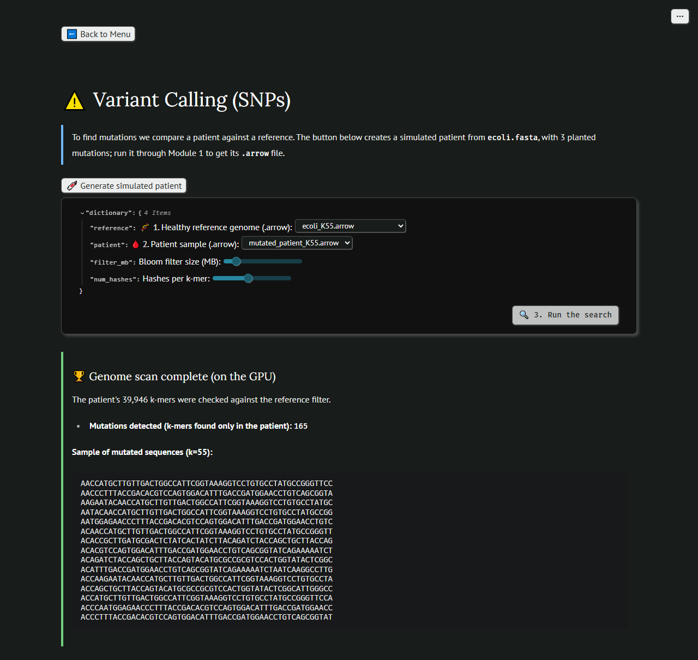

# 🧬 MMGEN: MultiMerge Genomics Engine Suite


MMGEN is a free, open-source genomics toolkit written in **Rust**, with optional **CUDA** acceleration and a **Python** API. It has two families of tools:

* **Everyday file tools that work at any size** — validate a file and say what is wrong with it, fix `chr1` versus `1`, tell GRCh37 from GRCh38, and sort, merge and intersect VCF, BED, GFF/GTF and SAM files that do not fit in memory.
* **K-mer modules** — ingestion and quality filtering, De Bruijn assembly, mutation detection with Bloom filters, translation and scaffolding, running on an NVIDIA GPU when there is one and on the CPU when there is not.

You can use it from Python, from a reactive web interface (marimo), or from a Google Colab notebook with nothing installed on your machine.

MMGEN is free (Apache 2.0). If it is useful to you, you can [support its development](#donate) — entirely optional.

---

## ✨ Highlights

* **Any size.** Sorting is bounded by a memory budget, not by the input. Two real dbSNP VCFs totalling 18.7 GB of text (75.2 million variants) are sorted and merged in 242 s within a 1 GB budget on a 4-core laptop.
* **Stable, so merges are deterministic.** Records with the same key keep their input order: file order, then line order.
* **Errors that explain themselves.** The validator gives the line, the reason and the fix. An intersection between a `chr1` file and a `1` file fails with a message that names the mismatch instead of silently returning nothing.
* **No GPU required.** Every GPU path has a CPU twin that returns the same result, bit for bit. With a GPU, the Bloom filter is 3× to 8× faster.
* **One wheel per platform.** The extension is built against Python's stable ABI and serves every Python from 3.10 on.
* **Tested.** 232 Rust tests, plus Python tests that drive the API with real data and the interface in a real browser.

What the validator says about one of the example files of the Colab notebook, which has defects planted on purpose:

```text
examples/with_defects.vcf: VCF with 8007 lines and 8000 records -- 4 error(s), 1 warning(s)
  ERROR   line 8: the file mixes the two chromosome naming conventions: `chr1` (line 48) and `1` (line 8)
          fix: normalize_chromosomes(...) rewrites the file in a single naming convention
  ERROR   line 18: has 7 tab-separated column(s) but 8 when split on spaces: the columns must be separated by TABS (a VCF needs at least 8: CHROM POS ID REF ALT QUAL FILTER INFO)
          fix: replace the spaces between the columns with tabs
  ERROR   line 28: POS `12mil` is not an integer
  ERROR   line 38: REF `N?` has the invalid character `?` (only A, C, G, T and N are allowed)
  WARNING line 48: sequence `chr1` is not declared in any `##contig` line of the header
  INFO    line 10: the file is not sorted: sequence `1` shows up again here, after other sequences [7014 occurrences]
          fix: sort_genomic(...) sorts the file, whatever its size
```

---

## 🚀 The 10 Modules

Modules 1–8 have a screen in the web interface. Modules 9 and 10 are available from Python and from the Colab notebook.

### 🔬 1. Data Ingestion & Quality Control
* **Batch reading, gzip included:** reads several `.fastq`, `.fasta`, `.fastq.gz` or `.fasta.gz` files in parallel and decompresses them on the fly.
* **128-bit k-mers:** k-mers of up to `k=63` packed into 16 bytes each. The output is the sorted set of distinct k-mers.
* **Quality filter:** FASTQ reads whose mean Phred quality is below the threshold are dropped before their k-mers are extracted.

### 🧬 2. Taxonomic Clustering *(experimental)*
* Computes a MinHash signature per k-mer, projects it with PCA and groups the points with HDBSCAN.
* This is the oldest module and the least validated one: it works on 64-bit k-mers (`k=31`) read from text files, and its clustering quality has not been assessed. Treat it as a demonstration.

### 🧩 3. *De Novo* Assembly (De Bruijn Graph)
* Builds the De Bruijn graph of the k-mers in memory and walks its unbranched paths to produce contigs (unitigs), written to a FASTA file.
* Collapses the simplest bubbles (two one-node branches that reconverge). Longer bubbles, tips and coverage are not handled yet.

### ⚠️ 4. Variant Detection by K-mer Difference
* Builds a Bloom filter from the reference k-mers and reports the sample k-mers that are not in it — the k-mers that carry a difference. A single SNP shows up as `k` mutated k-mers.
* Runs on the GPU or on the CPU, with the same result.

### 📘 5. Translation
* Translates DNA into protein with the standard genetic code (reading frame 1), in parallel across sequences. Stop codons are marked.

### 🔍 6. Bloom Filters
* **GPU:** a CUDA kernel sets the bits with `atomicOr`, so thousands of threads can write the same filter safely.
* **CPU:** the same filter, bit for bit, on a machine with no NVIDIA card.

### 🖇️ 7. Scaffolding & Circularization
* Joins contigs whose ends overlap exactly by a fixed number of bases, using hash maps of the ends.
* Detects sequences that close on themselves (plasmids, circular chromosomes) without looping forever.

### 🗄️ 8. VCF Multimerge & Sorting
* Select any number of `.vcf` / `.vcf.gz` files: the engine merges them into a single output sorted by position or by quality — stable, and out of core when the data does not fit in memory.

### 📏 9. Sorting & Interval Operations at Any Size
* **`sort_genomic`** sorts VCF, BED, GFF/GTF and SAM. What fits the memory budget is sorted in memory; what does not is cut into sorted runs on disk (LZ4) and joined by a k-way merge.
* **The chromosome order you choose:** lexical (`bedtools sort`), natural (`chr2` before `chr10`), the order of the header's `##contig` / `@SQ` lines (`bcftools sort`, `samtools sort`), or the order of a `.fai` file.
* **`bed_merge`** (`bedtools merge -d`) and **`bed_intersect`** (`bedtools intersect`, with the `-u` and `-v` variants), on inputs that need not be sorted and need not fit in memory.
* **Compressed in, compressed out:** reads plain text, `.gz` (BGZF included) and `.lz4`; the output extension picks the compression. Malformed lines are skipped and counted, never silently sorted as zero.

### 🩺 10. File Validation & Naming Sanity
* **`validate_file`** reads a VCF, BED, GFF/GTF, SAM, FASTA or FASTQ of any size and reports each kind of problem with the **line** of its first occurrence, how many times it repeats and how to fix it.
* **`normalize_chromosomes`** rewrites a whole file, header included, in a single naming convention: UCSC (`chr1`, `chrM`) or Ensembl/NCBI (`1`, `MT`).
* **`compare_references`** compares the sequence lengths two files declare and tells GRCh37 (hg19) from GRCh38 (hg38) before the coordinates of one are used on the other.

---

## 💻 Quick Start

### Prerequisites
* Rust toolchain (`cargo`, `rustc`) — the stable channel is enough
* Python 3.10+
* NVIDIA CUDA Toolkit 11.8+ — optional, only for GPU acceleration
* On Windows: Visual Studio 2022 Build Tools

Pre-built wheels are not published yet; for now, build from source.

### Build and install
```bash
# from a clone of this repository
python -m venv .venv
.venv\Scripts\activate            # Windows
# source .venv/bin/activate       # Linux / macOS

pip install maturin
maturin develop --release         # builds the extension and installs it into the venv

# check the installation: any machine, no data needed, a few seconds
python trials/python/smoke.py
```

To build a wheel instead: `maturin build --release --locked -o dist`, then `pip install dist/*.whl`.

**No GPU? It still works.** Without the CUDA toolkit the build succeeds in CPU mode, and the GPU modules give the same results on the CPU. A build made with CUDA also runs on a machine with no usable NVIDIA card. `engine_info()` tells which build you have and whether a GPU is usable right now.

**Building with CUDA on Windows:** `nvcc` needs `cl.exe`. Either build from the "x64 Native Tools Command Prompt for VS 2022", or load that environment first with `call "...\VC\Auxiliary\Build\vcvars64.bat"`.

| Build variable | Effect |
| :--- | :--- |
| `MULTIMERGE_CPU_ONLY=1` | Do not try CUDA at all |
| `MULTIMERGE_CUDA_ARCH=sm_61` | Target architecture passed to `nvcc` (default: the toolkit's own default) |
| `MULTIMERGE_REQUIRE_CUDA=1` | Fail the build instead of falling back to CPU mode |

### Use it from Python
```python
import multimerge_genomics as mmg

print(mmg.engine_info())
# {'version': '0.1.0', 'gpu_compiled': True, 'gpu': True, 'gpu_memory_mb': [3371, 4095], 'threads': 8}

# What is wrong with this file?
report = mmg.validate_file("sample.vcf.gz")
print(report["text"])

# chr1 or 1? Same reference genome?
mmg.normalize_chromosomes("sample.vcf.gz", "sample.chr.vcf.gz", style="chr")
print(mmg.compare_references("sample.vcf.gz", "cohort.vcf.gz")["verdict"])

# Sort and merge files of any size, within a memory budget
records, runs, skipped = mmg.sort_genomic(["a.vcf.gz", "b.vcf.gz"], "merged.vcf.gz", memory_mb=1024)

# Intervals (inputs are lists of files)
n_read, n_written = mmg.bed_merge(["peaks.bed"], "peaks.merged.bed", distance=100)
n_lines = mmg.bed_intersect(["peaks.bed"], ["genes.bed"], "peaks_in_genes.bed", mode="regions")
```

Every function has a docstring: `help(mmg.sort_genomic)`.

### Launch the web interface
```bash
pip install marimo polars numpy scikit-learn pyarrow
marimo run ui_main.py
```

The interface lists the files of the folder it is started from, and writes its results there.



### Google Colab
[`colab/MultiMerge_Genomics_Colab.ipynb`](colab/MultiMerge_Genomics_Colab.ipynb) runs the validation, naming, sorting and interval tools in the browser: one form per task, with the code one double-click away. It creates its own example files, some with defects planted on purpose. Until a wheel is published, its first cell asks for a Linux wheel (`.whl`) of the package, which you can build with `maturin build` on any Linux machine.

#### The web interface on Colab

The marimo interface runs on Colab too, displayed inside the notebook. With the package installed and `ui_main.py` uploaded to the session (put your data files in the same folder), run this in a cell:

```python
!pip install -q marimo

import subprocess, time, urllib.request
subprocess.Popen(["python", "-m", "marimo", "run", "ui_main.py", "--headless", "--port", "2718", "--no-token"], cwd="/content")
for _ in range(60):  # wait until the server answers
    try:
        urllib.request.urlopen("http://127.0.0.1:2718/", timeout=2)
        break
    except OSError:
        time.sleep(1)

from google.colab import output
output.serve_kernel_port_as_iframe(2718, height=900)
```

> **Blank output? Allow third-party cookies for Colab.** Colab shows the interface in an iframe that depends on them. When the browser blocks them, the cell runs without any error and the output simply stays empty. In Chrome, click the crossed-out eye icon at the right end of the address bar and allow third-party cookies for the site; the page reloads, the session stays connected, and running the cell again shows the menu.

`--no-token` is fine here: the port is reachable only through your own Colab session.

---

## 📚 Python API

| Function | What it does |
| :--- | :--- |
| `engine_info()` | Version, whether CUDA was compiled in, whether a GPU is usable now, GPU memory, threads |
| `validate_file(path, format=None, max_lines=None)` | Validates VCF, BED, GFF/GTF, SAM, FASTA or FASTQ. Returns a dictionary: `valid`, `errors`, `warnings`, `lines`, `records`, `complete`, `sorted`, `naming`, `problems`, `text` |
| `normalize_chromosomes(input, output, style="chr", format=None, mapping=None)` | Rewrites a file with `chr1` (`"chr"`, `"ucsc"`) or `1` (`"no_chr"`, `"ensembl"`, `"ncbi"`) names |
| `file_reference(path)` | What a file declares about its reference: `assembly`, `declared`, `sequences` |
| `compare_references(a, b)` | Same reference genome? `compatible` (True / False / None) and a one-sentence `verdict` |
| `sort_genomic(paths, output, format=None, by="position", chrom_order=None, memory_mb=None, temp_dir=None)` | Sorts and merges VCF, BED, GFF/GTF or SAM of any size. Returns `(records, runs_on_disk, skipped_lines)` |
| `bed_merge(paths, output, distance=0, ...)` | Merges overlapping or nearby intervals. Returns `(read, written)` |
| `bed_intersect(a, b, output, mode="regions", ...)` | Intersects A with B; `mode` is `"regions"`, `"unique"` (`-u`) or `"absent"` (`-v`). Returns the number of lines |
| `multimerge_vcf(paths, sort_field, output_path, memory_mb=None, temp_dir=None)` | Merges VCFs sorted by `"POS"` or `"QUAL"` |
| `read_fasta_batch(paths, k)` / `read_fastq_batch(paths, min_quality, k)` | Distinct k-mers of the files, sorted, as bytes (16 per k-mer) |
| `build_debruijn_graph(kmer_bytes, k)` / `assemble_debruijn(kmer_bytes, k)` | Graph size `(nodes, edges)` / the contigs, longest first |
| `build_bloom_filter(kmer_bytes, size_mb, num_hashes, device="auto")` | Bloom filter of the k-mers, as bytes |
| `extract_mutations(sample_bytes, bloom_bytes, num_hashes, device="auto")` | The sample k-mers that are not in the filter |
| `translate_proteins(dna_sequences)` | One protein per DNA sequence |
| `build_scaffolds(sequences, overlap)` | `(scaffolds, circular)` |
| `decode_kmers_128(kmer_bytes, k)` | K-mers back to DNA strings |

* `by`: `"position"` (every format), `"quality"` (VCF, descending) or `"name"` (SAM, QNAME in natural order).
* `chrom_order`: `"lexical"`, `"natural"`, `"header"`, or the path of a `.fai` file. Default: the header for VCF and SAM, lexical for BED and GFF.
* `device`: `"auto"` (the fastest path this machine has), `"gpu"` (GPU only; raises an error if it cannot run there) or `"cpu"`.
* The GIL is released during file operations, so a user interface stays responsive.
* Four more functions serve the legacy 64-bit path of module 2: `sort_merge_bytes`, `read_and_merge_kmer_files`, `minhash_signatures` and `decode_kmers`.

---

## ⚡ GPU: what it speeds up, and what it does not

Bloom filter, 128-bit k-mers, 64 MB filter, 5 hashes; best of 3 runs.

| Hardware | k-mers | Build: CPU → GPU | Query: CPU → GPU |
| :--- | ---: | :--- | :--- |
| A100 vs 12 virtual cores | 10 M | 485 → 128 ms (**3.8×**) | 260 → 56 ms (**4.7×**) |
| A100 vs 12 virtual cores | 50 M | 2115 → 272 ms (**7.8×**) | 1276 → 211 ms (**6.0×**) |
| GTX 1050 Ti vs i7-7700HQ | 10 M | 767 → 248 ms (**3.1×**) | 583 → 125 ms (**4.7×**) |

* **Bloom filters gain from the GPU**, and more as the data grows.
* **Merging two sorted blocks does not**: moving the data to the card and back costs more than the merge itself, on both machines. `"auto"` merges on the CPU.
* **Sorting text files (VCF, BED, GFF, SAM) is not a GPU problem**: the measured bottleneck is reading and parsing lines.

## 📊 Measured on real data

4-core laptop (i7-7700HQ), about 3.5 GB of free RAM:

| Input | Size | Result |
| :--- | :--- | :--- |
| dbSNP b151 common, GRCh38 | 9.42 GB, 37.3 M variants | sorted in 164 s with a 1 GB budget (13 runs) |
| The two dbSNP b151 common files | 18.7 GB, 75.2 M variants | sorted and merged in 242 s with a 1 GB budget (25 runs) |
| RefSeq GRCh38.p14 GFF3 | 1.60 GB, 4.93 M records | sorted in 12.8 s with a 256 MB budget (8 runs) |

---

## 🧪 Testing

The tests live in `trials/`.

```bash
# Rust, standalone: needs neither CUDA nor Python
cd trials
cargo run --release                 # 102 tests: sorting, merging, intersection
cargo run --release --bin validate  # 30 tests: validator and chromosome names
cargo run --release --bin bloom     # 100 tests: CPU Bloom filter against a naive reference

# Python, with the extension installed
python trials/python/smoke.py                      # smoke test, no external data
python trials/python/test_ui.py ui_main.py         # the interface's cells, without a browser
python trials/python/test_browser.py ui_main.py    # the interface in a real browser (needs playwright)
python trials/python/gpu_test.py 1 10              # GPU against CPU against numpy; sizes in millions
```

## 🚧 Status and known limitations

MMGEN is alpha software (version 0.1.0). The file tools of modules 8–10 are the most mature part; the k-mer modules are closer to a teaching and research prototype.

* **K-mer modules work in memory.** "Any size" applies to modules 8–10, not yet to k-mers.
* **K-mers are strand-specific** (not canonical). Assembly and variant detection suit same-strand input, such as an assembled reference against a mutated copy of it; shotgun reads from both strands are not reconciled.
* **Variant detection reports k-mers**, not VCF records.
* **SAM is text only**: BAM and CRAM are not read. **Parquet is not supported.**
* `bed_merge` writes three columns (chromosome, start, end), like `bedtools merge` without `-c`.
* Reading and parsing lines uses a single core; that is where sorting time goes.
* Module 2 (clustering) is experimental — see above.
* The public API, the messages, the interface and this documentation are in English. Code comments and internal names are still in Portuguese.

## 💬 Feedback and contributions

Suggestions for improvements and requests for new features are welcome: [open an issue](../../issues/new/choose) and pick *Feature request or improvement*, or *Bug report* if something went wrong. To implement something yourself, see [CONTRIBUTING.md](CONTRIBUTING.md); pull requests are welcome.

## 📄 License

[Apache License 2.0](LICENSE).

---

<a id="donate"></a>

## 💛 Support the project (optional)

MMGEN is free and open source, and nothing in it is locked behind a donation. If it saved you time and you would like to help keep it maintained, a contribution is welcome at either address below.

| Currency | Network | Address |
| :--- | :--- | :--- |
| Bitcoin (BTC) | Bitcoin | `12Pea1apDcdMfeC1LgYHxW14QAPeyrL66h` |
| Ether (ETH) | Ethereum (ERC-20) | `0x7e4fc1627ee28bc6622c3e8209c7fc33157f3723` |

Please send only over the network shown for each address: a transfer made over a different network may not arrive, and it cannot be reversed. Copy the address rather than typing it, and compare its first and last characters before confirming.

Other ways to help cost nothing: star the repository, [report a bug](../../issues/new/choose) with a file that reproduces it, or [say which format or tool you miss](../../issues/new/choose).
